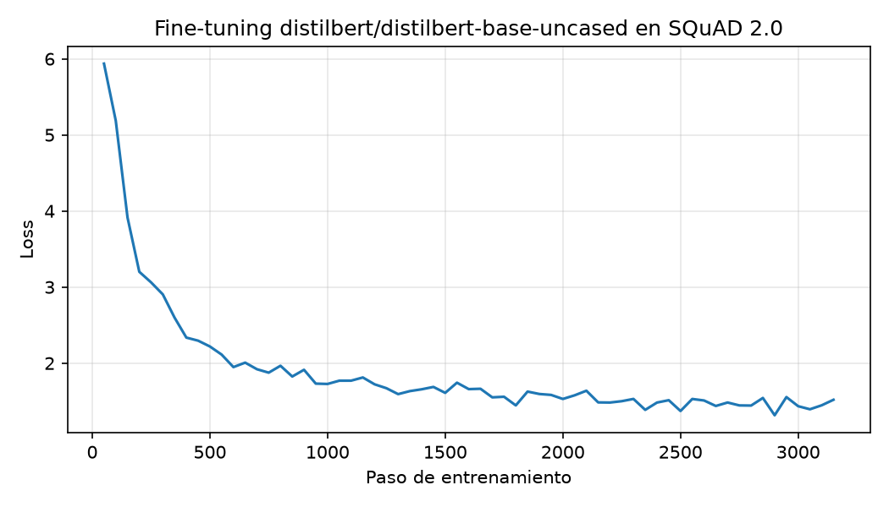

# REPORT

> Si el profesor entrego REPORT_TEMPLATE.md, copien aqui sus encabezados exactos.
> Ninguna seccion puede quedar vacia: un informe incompleto cuenta como no entregado.

## Team

- Team name:
- Members:

## Model choice and justification

We fine-tuned **DistilBERT** (`distilbert/distilbert-base-uncased`, ~66M parameters), a classic encoder.
Why DistilBERT:
- It is about 40% smaller and 60% faster than BERT-base while keeping most of its accuracy.
- The service runs on a laptop **CPU** with a 5-second timeout per request and a 150-second global cap, so inference speed matters more than a few extra points of accuracy.
- Bigger encoders (RoBERTa-base, DeBERTa-v3-base) could be more accurate, but they are slower on CPU and take longer to fine-tune, and we had very limited time.
- Decoders (GPT-style) are not allowed and do not fit exact-span answers.

## Training setup, loss curve and validation results

**Training setup** (script: `training/train.py`, config saved in `training/logs/train_config.json`):

| Setting | Value |
|---|---|
| Base checkpoint | distilbert/distilbert-base-uncased |
| Training data | SQuAD 2.0 train, random subset of 50,000 questions (seed 42) |
| Training windows (features) | 50,528 |
| Epochs | 1 |
| Batch size | 16 |
| Learning rate | 3e-5 (linear decay, 10% warmup) |
| Weight decay | 0.01 |
| max_seq_length / doc_stride | 384 / 128 |
| Precision | fp16 |
| Hardware | NVIDIA GeForce RTX 5060 Laptop GPU (8 GB) |
| Training time | ~6.3 minutes (3,158 steps) |

Unanswerable questions are trained to point at the `[CLS]` token (position 0). Long contexts are split into overlapping windows of 384 tokens with a stride of 128.

**Loss curve:** the training loss went down from 5.94 at the start to 1.52 at the end (average 1.90), so the model learned the task. Full log: `training/logs/log_history.json`.

**Validation results** (script: evaluation/choose_threshold.py, results saved in evaluation/threshold.json):

We evaluated on a random subset of 2000 questions from the SQuAD 2.0 validation set (seed 0), which the model never saw during training. About 48.95% of them are unanswerable.

| Metric | Value |
|---|---|
| Exact Match (tuned threshold) | 0.5865 |
| F1 (tuned threshold) | 0.6095 |
| Exact Match (threshold = 0) | 0.5590 |
| F1 (threshold = 0) | 0.5933 |
| Always-null baseline (Exact Match) | 0.4895 |

The model clearly beats the always-null baseline, and tuning the no-answer threshold improved Exact Match from 0.5590 to 0.5865.

## How we chose the no-answer threshold

For every question, the model produces two scores:
- **null score**: start logit + end logit of the [CLS] token (the "no answer" option). For long contexts split into several windows, we take the minimum null score across windows.
- **best span score**: the highest start logit + end logit among valid spans inside the context (end after start, at most 30 tokens, searching the top 20 start and end positions).

We compute diff = null_score - best_span_score. If diff > threshold, the service answers 
ull; otherwise it returns the best span.

To choose the threshold, we ran the model once on 2000 SQuAD 2.0 validation questions, stored each question's diff, and then tried every observed diff value as a candidate threshold. We kept the one with the highest Exact Match (F1 as a tie-breaker), where a correct 
ull on an unanswerable question counts as a correct answer. This is the same way the instructor scores each item.

The chosen threshold is **-1.224** (Exact Match 0.5865, F1 0.6095), compared to Exact Match 0.5590 with the default threshold of 0. The value is saved in evaluation/threshold.json, and the API reads it at startup, so evaluation and serving use exactly the same decision rule (shared code in qa_core.py).

## Serving architecture and tunnel

<!-- Persona 3: architecture. Persona 4: tunnel. -->

## Results on the public sample set

<!-- Persona 4 -->

## Model size and self-measured latency

<!-- Persona 3 / Persona 4 -->

## Problems encountered and how we fixed them

<!-- Everyone adds their own -->

## Decoder investigation

<!-- Persona 4 -->

## Known limitations

<!-- Persona 4 -->
